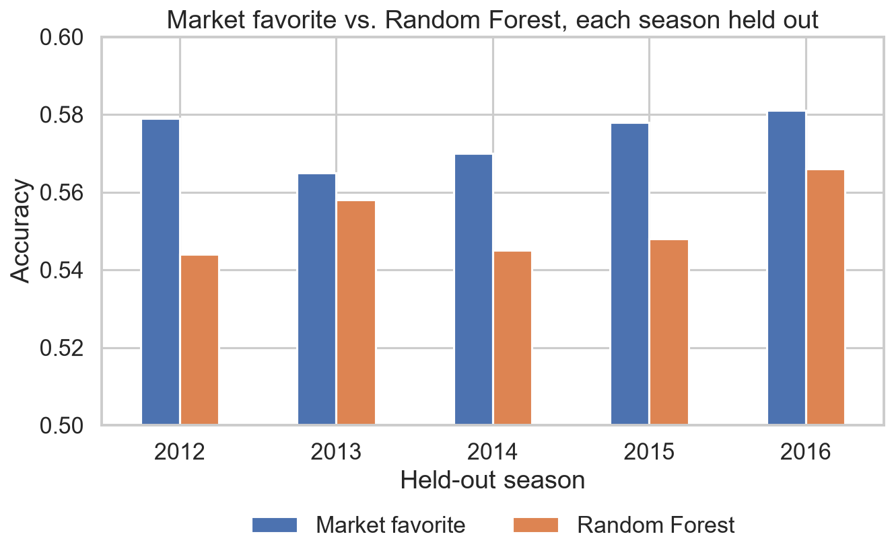

# MLB Game Outcomes vs. the Betting Market

**Can a machine-learning model built from public game data pick MLB winners better than the betting market? Across 12,146 games and five held-out seasons, it can't — the closing line wins every time.**

  

> **Team project:** built for Duke CS 216 (Everything Data), Fall 2025, as a five-person team. **My part:** I built the data pipeline merging the game logs with sportsbook odds, and trained and evaluated the Random Forest model against the market and baseline benchmarks. This repository is my cleaned-up version of the analysis, including a data-merge fix described below.

---

## The question

Sportsbooks set a closing moneyline for every game, which implies a probability that each team wins. If the betting market is efficient, those probabilities should already reflect everything public data can tell you. This project asks:

1. Why is the MLB run line almost always **±1.5 runs**?
2. Which pre-game features best predict **who wins** and **by how much**?
3. Can a Random Forest **beat the market favorite**?

## Data sources

| Dataset | Coverage used | License |
|---|---|---|
| [Major League Baseball Game Logs](https://www.kaggle.com/datasets/thedevastator/major-league-baseball-game-logs) (Dataquest, from [Retrosheet](https://www.retrosheet.org/)) | Final scores, 2012–2016 | CC BY-SA 4.0 |
| [MLB Odds Data](https://www.kaggle.com/datasets/christophertreasure/major-league-baseball-vegas-data) (Kaggle, C. Treasure) | Closing moneyline, run line and total, 2012–2016 | No license stated — not redistributed |

The odds dataset covers 2012–2021, but the game logs end in 2016, so the analysis uses the five overlapping seasons. Neither file is committed — see [data/README.md](data/README.md) to download them.

> The information used here was obtained free of charge from and is copyrighted by Retrosheet. Interested parties may contact Retrosheet at www.retrosheet.org.

## Approach

1. **Merge** game logs with closing odds on date, teams **and final score**. Matching on date and team alone (as the original course version did) cross-joins the two games of a doubleheader with both games' odds — 936 duplicated rows, half carrying the wrong line. Matching on the score pairs 12,146 of 12,148 games with their own line.
2. **Market features:** convert moneylines to implied probabilities and remove the bookmaker's margin (vig).
3. **Pre-game features (18):** market probabilities and total, per-season Elo ratings (computed before each game), park factor, rest days / back-to-backs / home-away switches, and runs scored and allowed over the previous 3 days.
4. **Models:** Random Forest classifier (home win) and regressor (|run margin|), 400 trees each.
5. **Evaluation:** train/test split **grouped by season** so an entire season is held out (no leakage across games in the same season), compared against a majority-class dummy and the market favorite. Then repeated with each of the five seasons held out in turn.

## Results

**Held-out 2013 season (2,431 games)**

| Model | Accuracy | Log loss | Brier |
|---|---|---|---|
| Dummy (always pick home team) | 53.8% | — | — |
| **Market favorite** (closing line) | **56.5%** | **0.676** | **0.241** |
| Random Forest (18 features) | 55.8% | 0.692 | 0.249 |

**Every season held out in turn** — the market favorite beats the model in **5 of 5** seasons on both accuracy and log loss:



| Held-out season | RF accuracy | Market accuracy | RF log loss | Market log loss |
|---|---|---|---|---|
| 2012 | 54.4% | 57.9% | 0.697 | 0.676 |
| 2013 | 55.8% | 56.5% | 0.692 | 0.676 |
| 2014 | 54.5% | 57.0% | 0.691 | 0.677 |
| 2015 | 54.8% | 57.8% | 0.688 | 0.676 |
| 2016 | 56.6% | 58.1% | 0.689 | 0.673 |

**Other findings**

- **The ±1.5 run line:** 29.5% of games are decided by exactly one run and 70.5% by two or more, so 1.5 is the natural split. Closing total and favorite strength explain almost none of the variation in margin (R² = 0.005).
- **What predicts winners:** the market's own implied probabilities dominate permutation importance; Elo, rest and recent-form features add little on top of the closing line.
- **Margins are not predictable** from these features: the Random Forest regressor has MAE 2.06 runs and R² = −0.06 (worse than predicting the mean).

**Bottom line:** the closing line already prices in the public information these features capture — consistent with an efficient MLB betting market.

All numbers come from [`notebooks/mlb_game_outcomes.ipynb`](notebooks/mlb_game_outcomes.ipynb) and are saved in [`results/`](results/).

## How to run

```bash
git clone https://github.com/connorleathe/mlb-game-outcomes.git
cd mlb-game-outcomes
python -m venv .venv
source .venv/bin/activate        # Windows: .venv\Scripts\activate
pip install -r requirements.txt

# Download the two CSVs into data/raw/ (see data/README.md), then:
jupyter nbconvert --to notebook --execute --inplace notebooks/mlb_game_outcomes.ipynb
# or open it interactively:
jupyter lab notebooks/mlb_game_outcomes.ipynb
```

The full notebook runs in under two minutes on a laptop.

## Project structure

```
src/mlb_outcomes/
  data.py        load game logs + odds, score-aware merge, vig-free probabilities
  features.py    Elo, park factor, rest / back-to-back, last-3-days form
notebooks/
  mlb_game_outcomes.ipynb   analysis (Q1–Q3) with outputs
  build_notebook.py         regenerates the notebook from source
figures/         charts saved by the notebook
results/         metrics.json, leave_one_season_out.csv
data/README.md   where to download the data
```

## Next steps

- **Starting-pitcher features** (ERA, K-BB%, recent form) — the biggest pre-game signal missing from this dataset.
- **Extend to 2017–2021** by sourcing game logs for those seasons (the odds already cover them).
- **Model the residual:** predict where the model disagrees with the market and test whether those games have positive expected value after the vig.
- **Prior-season park factors** — the current park factor uses same-season run scoring, which leaks a little information from the test season.

## License

Code: [MIT](LICENSE). Data: see the licenses of the source datasets above.
